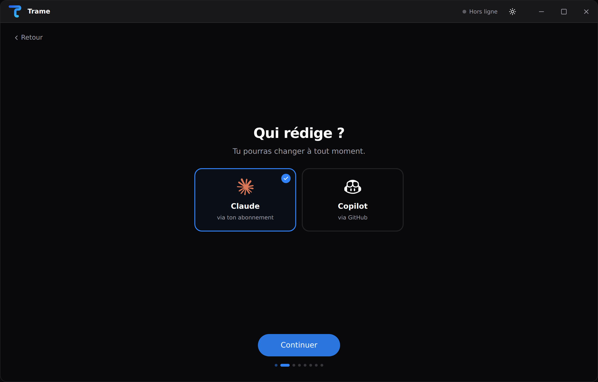
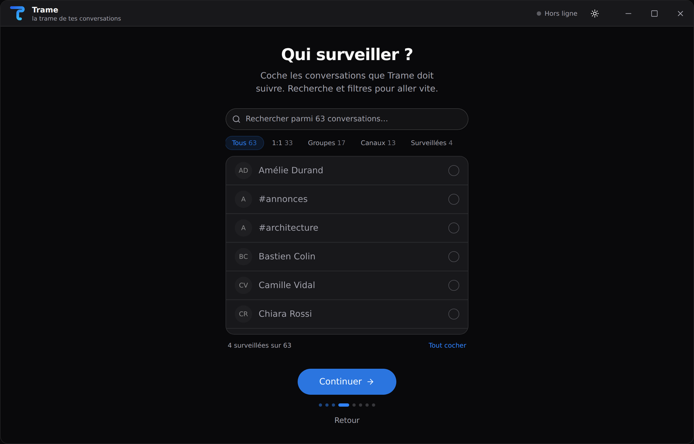
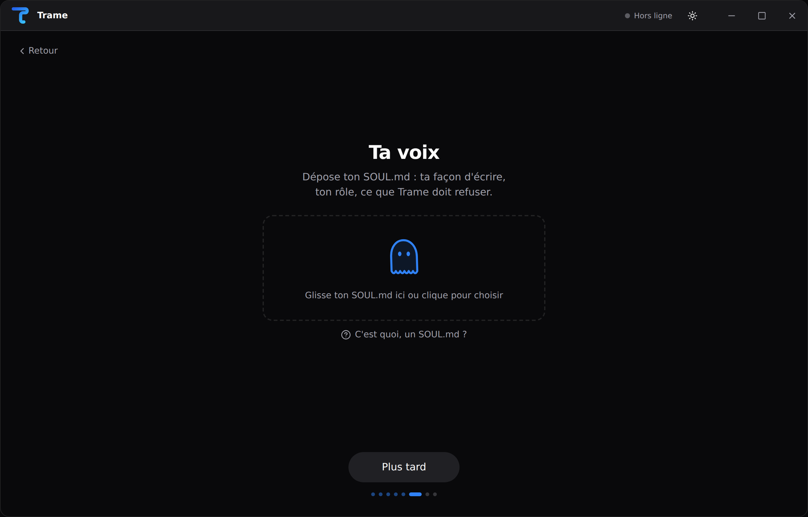
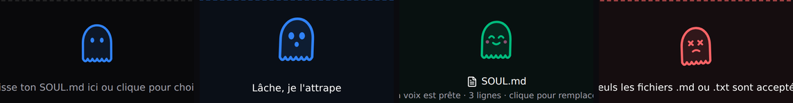
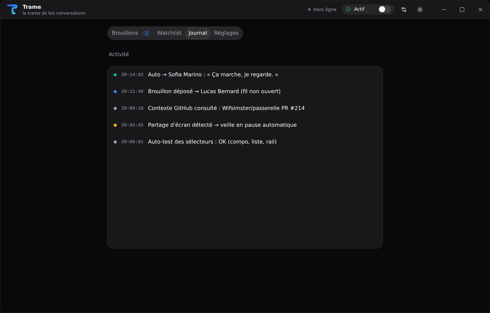
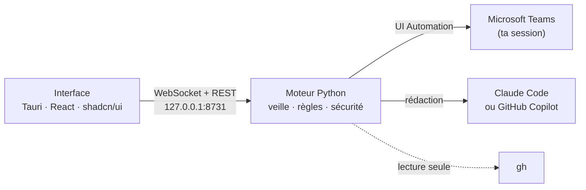

<p align="center">
  
</p>

<h1 align="center">Trame</h1>

<p align="center"><strong>La trame de tes conversations.</strong><br/>
Un assistant Windows qui veille sur tes conversations Microsoft Teams et te prépare des réponses, dans ta voix.</p>

<p align="center">
  <a href="https://github.com/DamienBattistella/trame/actions/workflows/ci.yml"></a>
  <a href="https://github.com/DamienBattistella/trame/actions/workflows/build.yml"></a>
</p>

<p align="center">
  
</p>

---

## Ce que fait Trame

Trame tourne en tâche de fond, dans la barre des tâches. Quand quelqu'un que tu as choisi t'écrit sur Teams, Trame lit le message, rédige une réponse dans ton style et te la propose. Tu relis, tu ajustes, tu envoies — ou, pour les personnes de confiance, Trame envoie lui-même après un court délai que tu peux annuler.

- **Il pilote l'application Teams que tu as déjà ouverte.** Aucune application Microsoft Graph à enregistrer, aucun jeton stocké, aucune autorisation d'administrateur : Trame agit dans ta session, par les mêmes appels que Teams fait déjà (le jeton ne quitte jamais la page), et retombe sur l'interface de Teams quand un appel n'aboutit pas.
- **Il écrit dans ta voix.** Ton style, ton rôle et ce qu'il doit refuser sont décrits dans un fichier `SOUL.md` que tu déposes dans l'application.
- **Tu gardes la main.** Brouillon par défaut, envoi automatique seulement pour les conversations que tu désignes, pause en un clic.

## Interfaces

### Un démarrage en huit écrans

| | |
|:-:|:-:|
|  |  |
| **Bienvenue** — Trame détecte Teams | **Cerveau** — Claude ou GitHub Copilot |
|  |  |
| **Vérification** — Trame repère la fenêtre, les messages et la zone de saisie | **Quelles conversations** — recherche et filtres, même avec des centaines de conversations |
|  |  |
| **Qui envoie** — toi ou Trame, par conversation | **Ta voix** — dépose ton `SOUL.md`, avec une aide et un modèle à copier |

<p align="center">
  <br/>
  <sub>L'âme de Trame réagit au dépôt du <code>SOUL.md</code> : elle attend, s'approche quand un fichier arrive, l'absorbe avec plaisir — ou secoue la tête si ce n'est pas le bon format.</sub>
</p>

### Au quotidien

| | |
|:-:|:-:|
|  |  |
| **Brouillons** — leur message, ta réponse modifiable, un bouton Envoyer | **Conversations** — lesquelles suivre, et qui envoie |
|  |  |
| **Journal** — tout ce que Trame a lu, proposé et envoyé | **Réglages** — cerveau, démarrage, GitHub, sécurité |

### Le brief d'une conversation

<p align="center">
  <br/>
  <sub>Depuis une réponse à relire (menu …) ou une conversation, « Résumé » résume la discussion, liste les points ouverts et retrouve les PR, issues et commits liés sur GitHub.</sub>
</p>

<p align="center">
  <br/>
  <sub>Au démarrage, le fil du logo écrit le T de Trame pendant que le moteur se lance.</sub>
</p>

## Fonctionnalités

- **Veille ciblée** : seulement les conversations que tu coches — messages privés, groupes, canaux. Dans un groupe ou un canal, Trame ne réagit que si l'on te mentionne, ou une personne que tu as nommée.
- **Deux modes par conversation** : *Brouillon* (tu valides) ou *Auto* (envoi après un compte à rebours de 3, 5 ou 10 s, annulable par la pause).
- **Brouillons éditables** : tu modifies le texte avant l'envoi, ou tu l'ouvres directement dans Teams pour le terminer toi-même.
- **Mentions** : « @ » dans la zone de saisie propose les gens de la conversation et de ton entourage ; à l'envoi, Trame choisit la personne dans les suggestions de Teams, qui la notifie comme une vraie mention. Si Teams ne propose pas exactement une personne de ce nom, rien ne part.
- **Pièces jointes** : trombone, glisser-déposer ou **Ctrl+V d'une capture d'écran** dans la zone de réponse ; les images et fichiers reçus s'affichent dans la discussion. Un texte collé (même copié depuis Word avec une image) reste du texte.
- **Favoris** : épingle une conversation en haut de la liste, dans sa catégorie « Favoris » (étoile au survol d'une ligne ou dans l'en-tête de la discussion, clic droit, ou **Alt+F**). Ordre choisi par glisser-déposer, **Ctrl+Maj+↑ / ↓** ou le clic droit ; indépendant de « Suivie » ; Ctrl+K les propose en premier. Gardés dans `config.json` d'une mise à jour à l'autre.
- **Tout au clavier** : **Ctrl+K** pour aller à une conversation (quelques lettres, Entrée), **Alt+↓ / Alt+↑** pour la conversation non lue ou à relire suivante / précédente, **Alt+Maj+↓ / ↑** pour la suivante / précédente dans la liste, **↑ / ↓** pour parcourir la liste, **Échap** pour revenir de la discussion à la liste (le brouillon reste), **Ctrl+/** ou **?** pour l'aide des raccourcis. Hors Ctrl+K, Échap et l'aide, ils se taisent pendant la saisie ; dans la zone de réponse, Entrée, Maj+Entrée, Tab, @ et Échap gardent leur rôle.
- **Rattrapage** : en un clic, les messages non lus deviennent des brouillons — jamais d'envoi automatique en rafale.
- **Brief de conversation** : en un clic, un résumé de la discussion, les points ouverts, les sujets abordés et les PR, issues et commits GitHub liés, chacun avec la raison du lien. Activable et réglable (20, 30 ou 50 derniers messages) dans les réglages.
- **Connexion GitHub intégrée** : « Se connecter à GitHub » dans le wizard ou les Réglages affiche le code à usage unique ; la connexion passe par `gh`, et Trame signale les organisations qui exigent le SSO.
- **Contexte GitHub** (lecture seule) : quand un message parle d'une PR ou d'une issue, Trame consulte tes dépôts pour répondre juste. Il n'écrit jamais sur GitHub.
- **Réponses tirées des dépôts** (lecture seule) : quand un collègue pose une question sur un produit, un outil ou une procédure, Trame choisit les dépôts concernés (ceux de ton compte et de tes organisations), parcourt leur documentation et leur code, lit les pages utiles et rédige une réponse sur le fond. Le cerveau ne fait que choisir dans les listes que Trame lui montre : il n'a aucun outil. Compte une trentaine de secondes de plus par brouillon ; le rattrapage s'en passe. Désactivable avec `"knowledge": false` dans `context.github` de `config.json`.
- **Mise à jour automatique** : au lancement, Trame vérifie la dernière version publiée sur GitHub, la télécharge, l'installe et redémarre. Les mises à jour sont signées ; une mise à jour non signée ou corrompue est refusée.
- **Transcriptions de réunion** (onglet *Réunions*, Teams intégré) : Trame liste tes réunions Teams terminées qui ont une transcription et en enregistre le fichier `.vtt` sur ton poste (`Documents\Trame\Transcriptions` par défaut), au format des transcriptions Teams (`<v Orateur>`), prêt pour un compte-rendu. Il relit l'onglet *Transcript* du récapitulatif, y compris quand Teams réserve le téléchargement à l'organisateur ; rien n'est écrit dans Teams ni envoyé ailleurs. Aussi via MCP : `list_meetings`, `get_meeting_transcript`.
- **Compte-rendu de réunion** (onglet *Réunions*, bouton *Compte-rendu*) : Trame applique un skill de compte-rendu (`meeting-report` par défaut, installé dans un dossier de skills) à la transcription `.vtt`, récupérée d'abord si besoin. Un dialogue montre en direct le prompt exact envoyé au cerveau, sa réflexion et ses étapes, les questions du skill (réponse par boutons ou texte, l'échange continue) et le compte-rendu en Markdown, à copier ou enregistrer en `.md` à côté du `.vtt`. Ce que le skill ferait ailleurs (issues, dépôt) reste du texte proposé ; rien n'est publié dans Teams. Aussi via MCP : `get_meeting_report`.
- **Skills d'agent** (*Réglages › Skills*) : Trame lit les skills au format partagé par Claude Code, Copilot et `npx skills` (un dossier par skill, un `SKILL.md` avec `name` et `description` en en-tête), dans son propre dossier (`%APPDATA%\Trame\skills`, actifs d'office), dans des dossiers partagés (`~/.agents/skills` par défaut) ou dans un dépôt git cloné en https. Quand il rédige (proposition, correction, vérification, relance, résumé), le cerveau voit le nom et la description des skills actifs et ne lit le texte d'un skill que si la tâche le demande ; le panneau Réflexion dit lequel a été chargé. Aussi via MCP : `list_skills`.
- **Serveur MCP local** (facultatif) : Claude Code, Copilot ou Jarvis lisent tes discussions et te proposent des réponses via `http://127.0.0.1:8731/mcp` (jeton). Aucun outil n'envoie : une réponse proposée attend ton clic dans « À relire ».
- **Journaux pour le débogage** : traces et journaux OpenTelemetry (OTLP/HTTP ou fichier local), export manuel en un clic (copier ou fichier), texte des messages masqué par défaut.
- **Application de bureau discrète** : icône dans la barre des tâches, démarrage avec Windows, fermer la fenêtre la réduit, instance unique, taille et position mémorisées.

## Sécurité

- **Jamais dans la mauvaise conversation.** Avant de taper quoi que ce soit, Trame ouvre la conversation visée et vérifie qu'elle est bien active ; s'il a le moindre doute, il refuse et garde le brouillon.
- **Pause automatique pendant un partage d'écran**, pour qu'aucune réponse ne s'affiche devant toute une réunion. Avec Teams intégré, Trame le sait par ton statut : quand Teams affiche « En présentation », rien n'est tapé (les messages attendent dans la file d'envoi) et les notifications cachent le texte des messages ; tout reprend à la fin de la présentation.
- **Jamais deux fois, jamais pour lui-même.** Un brouillon ne peut partir qu'une fois, même en double-cliquant ; Trame ne répond ni à tes propres messages ni à ses propres réponses. Avant de taper, il vérifie que Teams est au premier plan et que la zone de saisie est vide, pour ne rien mélanger à un texte en cours.
- **Pause et partage d'écran revérifiés au dernier moment**, juste avant la saisie : une pause ou un partage commencés pendant la rédaction annulent l'envoi automatique.
- **Moteur local fermé au web.** Le moteur n'écoute que sur ta machine et ne répond qu'à l'interface de Trame : une page web ouverte dans ton navigateur ne peut ni lire tes messages ni déclencher un envoi. Quand tu quittes Trame, le moteur s'arrête avec lui.
- **Un cerveau sans outils.** Claude et Copilot reçoivent le message à rédiger, sans accès à tes fichiers, à tes commandes ni à tes serveurs MCP : un message piégé ne peut rien lui faire exécuter.
- **Un skill reste du texte.** Ses scripts ne sont jamais exécutés (l'écran Skills signale ceux qui en contiennent), seuls les fichiers texte de son dossier sont lisibles, dans une limite de taille, et ses consignes passent après les règles de Trame : il ne donne au cerveau aucun outil et ne change rien aux garde-fous d'envoi. Les skills des dossiers partagés et des dépôts restent désactivés tant que tu ne les actives pas.
- **Mots bloquants** : si un message ou une réponse contient un terme sensible (RH, salaire, confidentiel…), l'envoi automatique repasse en brouillon.
- **Auto-test au démarrage** : si Trame n'arrive pas à repérer les éléments de Teams, tout l'envoi automatique est suspendu.
- **Ce qui sort de ton poste** : le contenu des messages traités est envoyé au cerveau que tu as choisi (Claude ou GitHub Copilot) pour rédiger la réponse. Rien d'autre ne quitte la machine. La configuration est stockée dans `%APPDATA%\Trame`.
- **GitHub passe par `gh`.** La connexion se fait avec la commande `gh` du poste (code à usage unique dans le navigateur) ; le jeton reste dans le coffre d'identifiants de `gh` et Trame ne le voit jamais. Pour une organisation protégée par SSO (SAML), le jeton doit y être autorisé, sinon Trame la signale comme bloquée.

## Installer

1. Télécharge l'installeur Windows depuis la [dernière version](https://github.com/DamienBattistella/trame/releases/latest) : `Trame_x.y.z_x64-setup.exe`.
2. Vérifie que la commande `claude` (Claude Code) est installée et connectée sur le poste — ou `gh` avec Copilot si tu choisis ce cerveau.
3. Ouvre Teams, lance Trame et laisse-toi guider.

## Comment c'est construit



| Dossier | Rôle |
|---|---|
| `ui/` | Interface React (Vite, Tailwind v4, shadcn/ui, Motion) |
| `ui/src-tauri/` | Application Windows : fenêtre, barre des tâches, démarrage auto, moteur embarqué |
| `backend/` | Moteur : veille, règles de déclenchement, file de brouillons, API locale |
| `backend/drivers/` | Pilotage de Teams : `windows_uia` (réel) et `mock` (développement) |
| `tools/probe-teams.ps1` | Sonde UIA à lancer sur un poste avec Teams |
| `DESIGN.md` | Spécification et registre des décisions |

## Développer

Moteur (driver simulé, utilisable sur n'importe quel OS) :

```bash
cd backend
python3 -m venv .venv && . .venv/bin/activate
pip install -r requirements.txt -r requirements-dev.txt
python -m pytest -q tests
TRAME_DRIVER=mock python run.py          # API sur 127.0.0.1:8731
TRAME_DRIVER=mock TRAME_BRAIN=mock python run.py   # démo hors ligne, sans appel à claude ni à Copilot
```

`TRAME_BRAIN=mock` remplace le cerveau choisi (Claude ou Copilot, y compris après un changement dans les réglages) par un cerveau simulé et déterministe : brouillons plausibles et résumés de conversation (`POST /api/threads/{id}/brief`) construits à partir des conversations d'exemple, sans consommer d'abonnement. La recherche GitHub du résumé reste réelle (lecture seule, via `gh`) tant qu'elle est activée dans les réglages.

Interface :

```bash
cd ui
npm install
npm run dev                              # http://localhost:5173
npm run tauri dev                        # application de bureau (Windows, Rust requis)
```

Sans moteur, l'interface (dans un navigateur) fonctionne avec des données d'exemple.

### Instance d'essai, à côté du Trame installé

`npm run tauri dev` se bat avec le Trame installé (même port 8731, instance unique). Pour vérifier une modification dans la vraie application sans quitter son Trame, lancer **Trame (essai)** :

```powershell
cd backend
python -m venv .venv
.venv\Scripts\pip install -r requirements.txt
cd ..\ui
npm run tauri:essai
```

| | Trame installé | Trame (essai) |
|---|---|---|
| Moteur | sidecar embarqué, `127.0.0.1:8731` | sources de ce dépôt (`backend/.venv`, ou `TRAME_PYTHON`), `127.0.0.1:8732` |
| Interface | `tauri://localhost` | Vite sur `http://localhost:5174` (`ui/.env.essai`) |
| Identifiant, instance unique | `ovh.battistella.trame` | `ovh.battistella.trame.essai` |
| Données (`TRAME_HOME`) | `%APPDATA%\Trame` | `%APPDATA%\ovh.battistella.trame.essai` |
| Profil Teams intégré | `%LOCALAPPDATA%\ovh.battistella.trame\teams-web` | `%LOCALAPPDATA%\ovh.battistella.trame.essai\teams-web` |
| Démarrage auto, mises à jour | oui | non |
| Icône | bleue | ambre, info-bulle « Trame (essai) » |

La configuration vient de `ui/src-tauri/tauri.essai.conf.json`, fusionnée à `tauri.conf.json` seulement par `npm run tauri:essai` : le build de production ne change pas. `cargo` a besoin des icônes générées (`npx tauri icon src-tauri/icons/source.png`) et d'un fichier `src-tauri/binaries/trame-backend-x86_64-pc-windows-msvc.exe`, même vide (non utilisé par l'essai).

**Se connecter à Teams dans l'essai (une seule fois)** : le profil Teams intégré de l'essai est neuf. Au premier lancement, suivre l'accueil (ou cliquer sur « Afficher » à la ligne Teams des Réglages), se connecter dans la fenêtre « Teams · Trame (essai) », puis la masquer. La session est gardée pour les lancements suivants. Le Trame installé garde sa propre session, sans interruption.

Arrêter l'essai : *Quitter* dans le menu de son icône (ambre) ou `Ctrl+C` dans le terminal. Le moteur d'essai s'arrête avec lui.

### Versions et releases

Les releases sont automatiques et suivent le [versionnage sémantique](https://semver.org/lang/fr/). Après chaque CI verte sur `main`, `build.yml` déduit la version suivante des messages de commit ([Conventional Commits](https://www.conventionalcommits.org/fr/)) depuis le dernier tag, construit l'installeur Windows et publie une Release GitHub avec le manifeste de mise à jour automatique :

| Commit | Incrément |
|---|---|
| `feat: …` | mineur (0.**2**.0) |
| `fix: …`, `perf: …`, `refactor: …`, ou tout message libre | correctif (0.1.**2**) |
| `feat!: …` ou `BREAKING CHANGE:` dans le corps | majeur (mineur tant que la version est en 0.x) |
| uniquement `docs:`, `chore:`, `ci:`, `test:`, `style:`, `build:` | pas de release |

Une release peut aussi être forcée depuis l'onglet **Actions** › *Release (Windows)* › *Run workflow*, en choisissant l'incrément.

## État du projet

Le moteur, l'interface et l'application de bureau sont complets, testés (109 tests backend, CI verte) et le build Windows produit un installeur. Le pilotage réel de Teams (`backend/drivers/windows_uia.py`) doit encore être **calibré sur un poste Windows** : la nouvelle version de Teams change ses éléments d'interface d'une mise à jour à l'autre. La procédure est décrite dans [`docs/SONDE-UIA.md`](docs/SONDE-UIA.md). En attendant, toute étape incertaine échoue du côté sûr : Trame refuse d'écrire plutôt que de risquer la mauvaise conversation.
